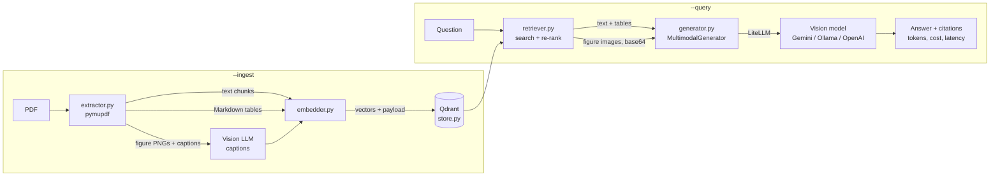

# multimodal-rag-poc

A proof-of-concept **multimodal RAG** (retrieval-augmented generation) pipeline for PDFs. It pulls **text, tables and figures** out of documents, indexes them in Qdrant, and answers questions with a vision-capable LLM that sees both the retrieved text and the retrieved chart images. Every answer cites its sources by page.

```text
$ python app.py --query "What is the Q3 revenue trend shown in the chart?"

Q: What is the Q3 revenue trend shown in the chart?

Revenue rose every quarter, from $42.1M in Q1 to $55.3M in Q3 [S1] ...

Sources:
  [S1] halcyon_fy2025_report.pdf, page 2 (table)
  [S3] halcyon_fy2025_report.pdf, page 1 (image)

gemini/gemini-3.8-flash | tokens 2310 in / 96 out | cost $0.00041 | retrieval 210 ms | LLM 2.4 s | total 2.6 s
```
*(Illustrative output; your numbers and wording will differ.)*

## Quickstart

Needs **Python 3.11+**. On a Mac, use `python3`; inside the virtual environment, `python` works.

**1. Get the code**
```bash
git clone https://github.com/perpetualxbeta-ai/multimodal-rag-poc.git
cd multimodal-rag-poc
```
No git? Download the ZIP instead:
```bash
curl -L https://github.com/perpetualxbeta-ai/multimodal-rag-poc/archive/refs/heads/main.zip -o rag.zip
unzip rag.zip && cd multimodal-rag-poc-main
```

**2. Install**
```bash
python3 -m venv .venv
source .venv/bin/activate          # run again in every new terminal
pip install -r requirements.txt    # light: no torch needed for the default setup
```

**3. Add your API key**

Get a free key at [Google AI Studio](https://aistudio.google.com/apikey), then:
```bash
cp .env.example .env
open -e .env                       # macOS: paste the key after GEMINI_API_KEY=
```

**4. Ingest a PDF, then ask questions**
```bash
python app.py --ingest samples/halcyon_fy2025_report.pdf
python app.py --query "What is the Q3 revenue trend shown in the chart?"
```
`samples/halcyon_fy2025_report.pdf` is a fictional 5-page annual report with text, two tables, raster and vector charts, and a diagram. Some questions to try:

| Question | Expected answer | Where it appears |
|---|---|---|
| What was the operating margin in Q3? | 32.0% | Table 1 (page 2) |
| Which region has the most installed capacity? | Northern, 420 MW | Figure 2, a vector bar chart, and the text (page 3) |
| What share of generation came from wind? | 27% | Figure 3, a pie chart, and the text (page 4) |
| What are the main risks for FY2026? | Grid curtailment, solar yield, battery supply, market rules | Text (page 5) |

### CLI reference

| Command | What it does |
|---|---|
| `python app.py --ingest FILE_OR_FOLDER ...` | Extract and index PDFs. Folders are searched recursively. Re-ingesting a file overwrites its old entries. |
| `python app.py --ingest ... --reset` | Delete the whole index first. Needed after changing embedding settings. |
| `python app.py --query "..."` | Retrieve evidence and answer with citations. |
| `--model MODEL` | Use a different answer model for this run, e.g. `--model ollama/llama3.2-vision`. |
| `--top-k N` | Number of sources to retrieve. |
| `--json` | Machine-readable output: answer, citations, token usage, cost, latencies. |
| `--config FILE` | Use another config file. |
| `-v` / `--quiet` | Debug logging / warnings only. |

`--ingest` and `--query` can be combined in one command. The index is stored on disk in `data/qdrant`, so ingest once and query as often as you like.

## Environment variables

API keys are read by [LiteLLM](https://docs.litellm.ai/) from the environment. Put them in `.env` (gitignored; see `.env.example`).

| Variable | Needed when | Notes |
|---|---|---|
| `GEMINI_API_KEY` | Any `gemini/...` model is used (the default for everything) | Free tier at [Google AI Studio](https://aistudio.google.com/apikey). The free tier is rate-limited, so the pipeline retries on HTTP 429. |
| `OPENAI_API_KEY` | You switch a model to an OpenAI one, e.g. `gpt-4o` | Not used by the default config. |
| `MMRAG_*` | Optional | Overrides any `config.yaml` value. Nested keys are joined with `__`, e.g. `MMRAG_LLM__MODEL=ollama/llama3.2-vision` or `MMRAG_RETRIEVAL__TOP_K=8`. |
| `MMRAG_CONFIG` | Optional | Path to a different config file. |

Precedence, highest first: CLI flags > environment variables > `.env` > `config.yaml` > built-in defaults. Before doing any work, the CLI checks that the models in use have their keys, and tells you which variable to set.

## Architecture



**Ingestion** (`--ingest`):
1. **Extract** (`src/extractor.py`). pymupdf reads each page and produces three chunk types:
   - **Text:** paragraphs, split into overlapping chunks of about 1,200 characters.
   - **Tables:** detected and converted to Markdown, so the LLM can read the rows and columns.
   - **Figures:** embedded images and vector charts, rendered to PNG in `data/processed/images/`, with their "Figure N: ..." caption attached. Logos and icons are filtered out.
2. **Embed** (`src/embedder.py`). Text and tables become vectors. Figures are handled by `image_strategy`:
   - `caption` (default): a vision LLM writes a description of each chart, and that description is embedded. Charts then become searchable by what they show, not only by their caption.
   - `clip`: local CLIP embeds the pixels directly, so a text query can match an image.
   - `both`: stores both.
3. **Store** (`src/store.py`). Vectors plus metadata (page, type, image path, caption, source file) go into one Qdrant collection with named vectors (`text`, `clip`). IDs are deterministic, so re-ingesting a file never creates duplicates.

**Querying** (`--query`):
1. **Retrieve** (`src/retriever.py`). The question is embedded and searched across the vector spaces; the results are merged with Reciprocal Rank Fusion. They are then re-ranked: the default keyword re-ranker boosts exact matches such as "Q3" or "32.0%". Near-duplicates are dropped, the number of images is capped, and the evidence is split into **text context** and **image file paths**. Each item gets a label `S1`, `S2`, ...
2. **Generate** (`src/generator.py`). `MultimodalGenerator` builds one prompt: grounding rules, the labelled text sources, each figure as its caption followed by the actual image (base64, downscaled), then the question. The model is told to use both the text and the figures, to cite every claim as `[S1]`, and to say so when the documents don't contain the answer.
3. **Report.** The result includes the answer, the sources it cited, prompt and completion tokens, estimated cost, and retrieval, LLM and total latency.

`src/pipeline.py` wires these together from `config.yaml`, and `app.py` is a thin CLI over it.

## Switching models with LiteLLM

Every model call goes through [LiteLLM](https://docs.litellm.ai/docs/providers), so switching provider means changing a **model string**, with no code changes. Models are set in `config.yaml`:

```yaml
embedding:
  text:
    provider: litellm
    model: gemini/gemini-embedding-001   # text + table embeddings
    dimension: 3072
  caption_model: gemini/gemini-3.8-flash # describes figures at ingest time
llm:
  model: gemini/gemini-3.8-flash         # answers questions
  fallback_models: []                    # tried in order if the main model fails
```

There are three ways to switch, from most to least permanent:
- **Edit `config.yaml`.**
- **Set an environment variable:** `MMRAG_LLM__MODEL=gpt-4o` in `.env`.
- **Use a CLI flag for one run:** `python app.py --query "..." --model gpt-4o`.

| Provider | Model string examples | Setup |
|---|---|---|
| Google Gemini | `gemini/gemini-3.8-flash`, `gemini/gemini-2.5-pro` | `GEMINI_API_KEY` |
| OpenAI | `gpt-4o`, `openai/gpt-4o-mini` | `OPENAI_API_KEY` |
| Ollama (local, free) | `ollama/llama3.2-vision`, `ollama/qwen2.5vl` | Install [Ollama](https://ollama.com), run `ollama pull llama3.2-vision`, and set `llm.api_base: http://localhost:11434` |

Model names change as providers release and retire them; check each provider's current model list. For example, the Gemini 1.5 models are retired, and Google currently recommends `gemini-3.8-flash` for new projects.

Notes on switching:
- **The answer model and the caption model** can be changed at any time. Use a vision-capable model so figures are actually seen. If LiteLLM knows a model can't take images, the pipeline sends captions only; `llm.send_images: true/false` forces either behaviour.
- **The embedding model** decides the vectors stored in the index. After changing `embedding.text.model`, `dimension` or `image_strategy`, re-ingest with `--reset`. The CLI detects a mismatch and tells you. Example for OpenAI: `model: text-embedding-3-small`, `dimension: 1536`.
- **Fallbacks:** `llm.fallback_models: [ollama/llama3.2-vision]` keeps answering if the Gemini free-tier quota runs out.
- **Fully local, with no API key:** run `pip install -r requirements-local.txt`, set `embedding.text.provider: local`, `model: sentence-transformers/all-MiniLM-L6-v2` and `image_strategy: clip`, and point `llm.model` at an Ollama vision model. On Apple Silicon, local models use the GPU (MPS) automatically.

## Configuration reference

All settings live in [`config.yaml`](config.yaml), with comments. The ones you're most likely to change:

| Setting | Default | Meaning |
|---|---|---|
| `qdrant.path` / `qdrant.url` | `data/qdrant` / unset | Local on-disk index, or a Qdrant server (`docker run -p 6333:6333 qdrant/qdrant`) |
| `extraction.chunk_size` | `1200` | Characters per text chunk |
| `embedding.image_strategy` | `caption` | `caption`, `clip` or `both` |
| `retrieval.top_k` | `6` | Sources passed to the model |
| `retrieval.max_images` | `3` | Figures sent as images; each one costs prompt tokens |
| `retrieval.reranker` | `keyword` | `none`, `keyword` or `cross-encoder` (local, needs `requirements-local.txt`) |

## Project layout

```
app.py                  CLI: --ingest / --query
config.yaml             models, store, retrieval settings
src/
  extractor.py          PDF -> text chunks, Markdown tables, figure PNGs
  embedder.py           text embedders, CLIP, vision captioner
  store.py              Qdrant collection, indexing, search
  retriever.py          search, re-rank, assemble labelled context
  generator.py          multimodal prompt + LiteLLM call, usage/latency tracking
  pipeline.py           wires the components together from config
  config.py             config.yaml + env loading
  models.py             Chunk data model
samples/                fictional sample report
scripts/                sample PDF generator
tests/                  pytest suite (no network or model downloads)
```

## Development

```bash
pip install -r requirements-dev.txt
pytest -q                                              # all tests; fakes replace models and APIs
ruff format . && ruff check --line-length 110 . && python -m mypy
python -m src.extractor samples/halcyon_fy2025_report.pdf   # inspect extraction only, no API calls
```

The tests never call a real model: embeddings and captions use deterministic fakes, and LiteLLM calls are stubbed or use LiteLLM's `mock_response`.

## Limitations

- Scanned PDFs (no text layer) are skipped, because OCR is not implemented.
- Running page headers and footers are kept in text chunks, which adds some retrieval noise.
- `--ingest` processes files one at a time; on the Gemini free tier, captioning many figures can hit rate limits (it retries automatically).
- Figure detection is heuristic. Unusual layouts may produce imperfect crops; check `data/processed/images/`.
